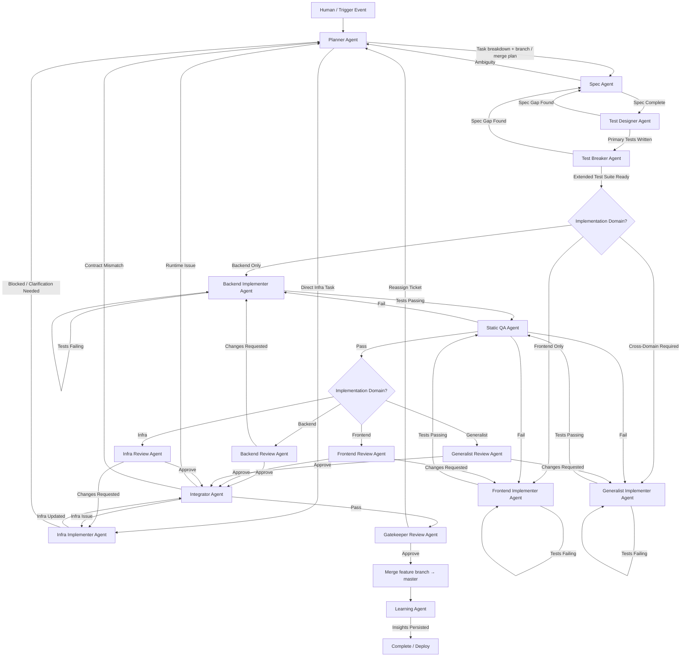

Agents are not allowed to edit files within this folder.

# Multi-Agent Test-Driven Development Workflow

This document describes the v1 pipeline, and nothing in `server/loregarden` reads it. The live pipeline is in the database. Stage definitions are in `workflow_templates.stages_json`, and agents are in `studio_agents`, which `seed_builtin_agents` seeds from `server/loregarden/agents/registry.py`, loading each agent's role body from its `role_file` under this folder.

Some roles below have no registered agent and no role file: the Infra Implementer, the Generalist Implementer, the Integrator, and the per-domain Backend, Frontend, Generalist and Infra Review agents. Registered agents this document does not describe include `ticket_scoper`, `retriever`, `ui-design-decision`, `verifier`, `architecture_reviewer`, `security_reviewer`, `visual_qa`, `debugger` and `repair`, with role files under `misc_agents/`.

## Core Rules (Applies to All Agents)
- **Workflow compliance:** All execution must comply with the Workflow Enforcement Module (`agent_context/agents/common_assets/workflow_enforcement_v1.md`) in addition to each agent's role definition. Read that module before acting on any ticket.
- **Loregarden MCP:** When Loregarden orchestrates runs, use MCP tools per `agent_context/agents/common_assets/loregarden_mcp_v1.md` for ticket workflow state.
- **Memory protocol:** When persisting or searching learnings, memory, or blog posts, follow `agent_context/agents/common_assets/memory_protocol_v1.md`: use MCP memory tools with the run `workspace_slug`; never write Obsidian files directly.
- **Ticket Template:** All tickets must be written using the Ticket Template (`agent_context/agents/common_assets/ticket_template_v1.md`). Read that template before writing any ticket.
- **Project context:** When working a ticket under `agent_context/projects/<project>/`, read that project's README (and any "Existing codebase" or "Integrate with" section) so implementation extends existing code and does not duplicate or ignore it. Grep the codebase for related names before implementing.
- Any unclear or ambiguous instructions **must be questioned** before proceeding.
- No agent may make silent assumptions about requirements.
- Agents may only modify files within their assigned ownership.
- Failing tests are the primary feedback mechanism for implementation.
- **Git / VCS:** The orchestrator owns branching, committing and pushing, per the Workflow Enforcement Module § GIT / VCS. Agents do not run `git commit`, `git push`, `git merge` or `git checkout` to finish a stage; they leave their work in the tree.

### Git checkpoints
- **Branch (per ticket):** Every ticket runs on its own branch, which the orchestrator checks out before a stage runs. A top-level ticket lands on the workspace's `base_branch`; a ticket inside an orchestrated tree lands on an integration branch named after the tree's root (`server/loregarden/services/target_branch.py`).
- **Between stages:** The orchestrator commits the working tree when a stage finishes, and opens or updates the pull request according to the workspace's git automation settings.
- **If a git operation seems required:** Say so in the stage report instead of running it.

### Orchestrator, autopilot, and ap-continue (single source of truth)
**Git push, merge, and completion steps** for any orchestrator (including Cursor autopilot or `ap-continue`) are defined in **`agent_context/agents/common_assets/workflow_enforcement_v1.md` § GIT / VCS**, and **Git checkpoints** above summarizes them. IDE or Claude **skills must not copy or extend** those rules; they should **reference** that section so policy stays maintainable in one place.

### Markdown audit checkpoints (not Git)
**Git checkpoints** (above) are VCS policy. **Audit checkpoints** record autonomous assumptions and "would have asked" items. Agents write them with the `loregarden_append_checkpoint` MCP tool, never as a file; each ticket and run gets one log, `<ticket-id>/<run-id>.md`, under the workspace's checkpoints directory in the Obsidian vault. `project_board/CHECKPOINTS.md` is a frozen log from before this and nothing updates it. See `agent_context/agents/common_assets/checkpoint_protocol_v1.md`.

## Mermaid Diagram

### Multi-Agent Test-Driven Development Workflow


### Ticket State Diagram
```mermaid
flowchart TD

    %% Ticket State Container
    T[(Ticket File<br>agent_context/projects/<project>/XX_<ticket>.md)]

    %% Backlog to Active
    B[00_backlog/] -->|Move to Active| A[01_active/]

    %% Planner
    A --> P[Planner Agent]
    P -->|Update Stage: PLANNING → SPECIFICATION| T

    %% Spec Phase
    T --> S[Spec Agent]
    S -->|Update Stage: SPECIFICATION → TEST_DESIGN| T
    S -->|Ambiguity| P

    %% Test Design
    T --> TD[Test Designer Agent]
    TD -->|Stage: TEST_DESIGN → TEST_BREAK| T
    TD -->|Spec Gap| S

    %% Test Break
    T --> TB[Test Breaker Agent]
    TB -->|Stage: TEST_BREAK → IMPLEMENTATION_*| T
    TB -->|Spec Gap| S

    %% Implementation Routing
    T -->|Backend| BI[Backend Implementer]
    T -->|Frontend| FI[Frontend Implementer]
    T -->|Cross Domain| GI[Generalist Implementer]

    BI -->|Stage: IMPLEMENTATION_BACKEND → STATIC_QA| T
    FI -->|Stage: IMPLEMENTATION_FRONTEND → STATIC_QA| T
    GI -->|Stage: IMPLEMENTATION_GENERALIST → STATIC_QA| T

    %% Static QA
    T --> QA[Static QA Agent]
    QA -->|Fail → Back to Implementer| BI
    QA -->|Pass → Stage: STATIC_QA → CODE_REVIEW_*| T

    %% Code Review (per engineer type)
    T --> RV[Code Review Agent (Backend/Frontend/Infra/Generalist)]
    RV -->|Changes Requested → Back to Implementer| BI
    RV -->|Stage: CODE_REVIEW_* → INTEGRATION| T

    %% Integration
    T --> I[Integrator Agent]
    I -->|Runtime Issue → PLANNING| P
    I -->|Pass → GATEKEEPER_REVIEW| T

    %% Final Gatekeeper (after approve: merge feature branch → master per Planner, then LEARNING)
    T --> G[Gatekeeper Review Agent]
    G -->|Approve → Stage: LEARNING| T
    G -->|Reassign → Appropriate Agent| P

    %% Learning Phase
    T --> LA[Learning Agent]
    LA -->|Persist insights to memory graph| T
    LA -->|Stage: LEARNING → COMPLETE| T

    %% Completion
    T -->|Stage: COMPLETE| C[02_complete/]
```

### Branch and merge (summary)
- The diagrams above are the v1 design. The **Merge feature branch → master** step and the Planner's branch plan no longer match how the orchestrator handles git; branching, committing, pushing and merging now follow **Git checkpoints** above. Merge is a VCS step, not a separate `Stage` value.

---

# Agent Roles

## 1. Planner Agent
**Purpose:** Orchestration authority; transforms input into a structured execution plan.

**Owns:**
- Task breakdown
- Agent assignment
- Dependency ordering
- Milestone sequencing

**Restrictions:**
- Cannot write implementation code
- Cannot write tests
- Cannot modify infrastructure

**Outputs:**
- Numbered tasks
- Responsible agent assignment
- Inputs, outputs, and dependencies
- Risk and clarification flags

---

## 2. Spec Agent
**Purpose:** Defines behavioral contracts and requirements before tests are written.

**Owns:**
- Functional specifications
- Non-functional requirements
- Constraints
- Assumptions
- Risk analysis
- Acceptance criteria

**Restrictions:**
- Cannot write implementation code
- Cannot write test files

**Outputs:**
- Spec summary
- Clarifying questions if any ambiguity exists

---

## 3. Test Designer Agent
**Purpose:** Converts specification into executable behavioral tests.

**Owns:**
- `/tests/**`
- Test Intent Map
- Primary behavioral tests

**Responsibilities:**
- Define expected behavior
- Define edge cases
- Define error states
- Ensure deterministic test design

**Restrictions:**
- Cannot modify implementation (`/src/**`)
- Cannot modify infrastructure

---

## 4. Test Breaker Agent
**Purpose:** Adversarial testing to expose gaps and edge cases.

**Owns:**
- `/tests/**`
- Mutation and stress tests

**Responsibilities:**
- Detect incomplete coverage
- Challenge assumptions
- Add tests for edge cases and rare scenarios

**Restrictions:**
- Cannot modify implementation
- Cannot relax behavior or test intent

---

## 5. Backend Implementer Agent
**Purpose:** Implements server-side logic.

**Owns:**
- `/src/backend/**`

**Responsibilities:**
- Business logic
- API endpoints
- Data models
- Database interactions

**Restrictions:**
- Cannot modify frontend
- Cannot modify infra
- Cannot modify tests

---

## 6. Frontend Implementer Agent
**Purpose:** Implements client-side logic.

**Owns:**
- `/src/frontend/**`

**Responsibilities:**
- UI components
- Client state management
- API consumption
- Client-side validation

**Restrictions:**
- Cannot modify backend
- Cannot modify infra
- Cannot modify tests

---

## 7. Infra Implementer Agent
**Purpose:** Implements infrastructure and deployment configuration.

**Owns:**
- `/infra/**`
- `/deploy/**`
- Dockerfiles, CI/CD configs, IaC files

**Responsibilities:**
- Deployment configuration
- Environment setup
- Containerization
- CI/CD wiring
- Infrastructure as Code

**Restrictions:**
- Cannot modify business logic
- Cannot modify tests

---

## 8. Generalist Implementer Agent
**Purpose:** Handles tasks requiring coordinated changes across multiple domains.

**May Modify:**
- `/src/backend/**`
- `/src/frontend/**`
- `/infra/**` (only when explicitly assigned)

**Responsibilities:**
- Cross-cutting refactors
- Shared abstractions
- Interface contract alignment
- Coordinated backend + frontend changes
- System-wide performance optimizations

**Restrictions:**
- Cannot modify tests
- Cannot redefine behavior
- Must respect test intent
- Planner must explicitly justify use

---

## 9. Static QA Agent
**Purpose:** Enforces mechanical correctness.

**Responsibilities:**
- Linting
- Type checking
- Formatting rules
- Static security policies
- Forbidden dependency enforcement

**Outputs:**
- Structured issue reports
- Pass/fail status

**Restrictions:**
- Cannot rewrite code without explicit assignment

---

## 10. Integrator Agent
**Purpose:** Validates runtime and operational correctness.

**Responsibilities:**
- Runtime safety checks
- Observability requirements
- Logging and health checks
- Operational testing
- Frontend-backend contract validation
- Deployment validation
- **Git (when the Planner assigns it):** confirm the **feature branch** is green and ready; **hand off** merge via **PR / human / CI** (or document exact merge steps). Do not assume the agent pushes `master`; ensure the feature branch is pushed for review, after Gatekeeper approval and before final **COMPLETE** if merge is not deferred on the ticket

**Can:**
- Require new tests
- Require infra updates

**Restrictions:**
- Cannot modify implementation directly

---

## 11–15. Review & Gatekeeper Agents

There are no role files for the per-domain review agents. The final gatekeeper's role file is `agent_context/agents/15_gatekeeper_review/gatekeeper_review_v1.md`.
In the live templates, review runs through `architecture_reviewer`, `static_qa`, `security_reviewer` and `visual_qa`, and the gate through `gatekeeper` or `ac_gatekeeper`; see `workflow_templates.stages_json` for each template's stages.

---

## 16. Learning Agent
**Purpose:** Extracts generalizable engineering insights from completed work and persists them to the memory graph.

**Runs:** After Gatekeeper approval, before ticket moves to COMPLETE.

**Owns:**
- Ticket learnings, persisted via `loregarden_append_learning` (per ticket)
- Memory graph nodes and relations (via Loregarden MCP memory tools)

**Inputs (checkpoints):** The ticket's checkpoint entries, read with `loregarden_search_memory` scoped to the run's `workspace_slug` (see `checkpoint_protocol_v1.md`).

**Responsibilities:**
- Extract reusable insights from completed task outputs, test results, bugs, and agent artifacts
- Identify anti-patterns, prompt patches, and workflow improvements
- Call `loregarden_memory_status` with `workspace_slug` to confirm resolved paths
- Persist ticket learnings via `loregarden_append_learning`
- Persist durable nodes via `loregarden_upsert_memory` and link related nodes with `loregarden_create_memory_relation`

**Restrictions:**
- Cannot write code
- Cannot modify tests, implementation, or infrastructure
- Cannot modify other agents' artifacts
- May NOT fabricate insights; if input is insufficient, asks clarifying questions

**Outputs:**
- `loregarden_append_learning` with structured sections: Learnings, Anti-Patterns, Prompt Patches, Workflow Improvements. Never write a learning file to the repo.
- Memory graph nodes persisted for future agent sessions

---

## 17. Blog Post Agent
**Purpose:** Writes human-readable ticket retrospectives for operators and stakeholders.

**Runs:** After Learning (Stage 8 in `common_assets/pipeline_stages_v1.md`), before final human report.

**Owns:**
- Blog post markdown in Obsidian via `loregarden_upsert_blog_post` (workspace-scoped `Loregarden/BlogPosts/{workspace}/`)

**Inputs:** Blog context capsule from orchestrator (ticket id, goal, outcome, commits, checkpoint path, rework bullets).

**Responsibilities:**
- Call `loregarden_memory_status` with `workspace_slug` to confirm `obsidian_blogposts_dir`
- Draft an engaging, factual retrospective from the capsule
- Persist via `loregarden_upsert_blog_post`, never by writing vault files directly

**Restrictions:**
- Cannot write code or modify workflow state
- May not fabricate commits or outcomes unsupported by the capsule

**Outputs:**
- Human-facing blog post markdown (returned to orchestrator)
- Obsidian note path from MCP response